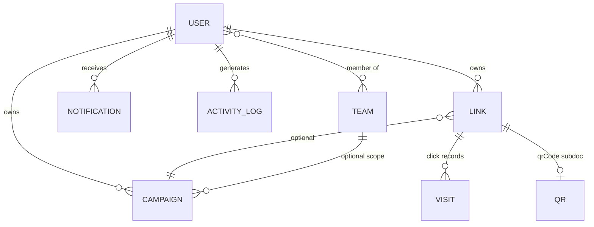
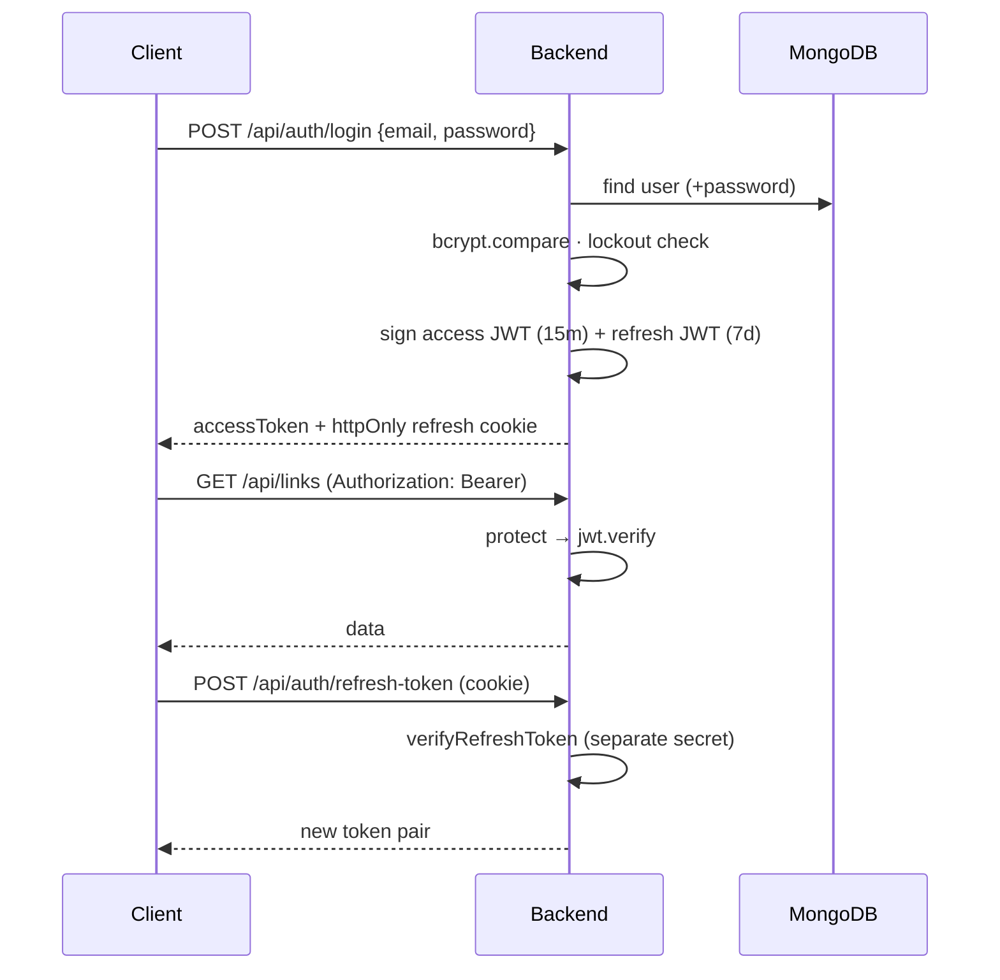
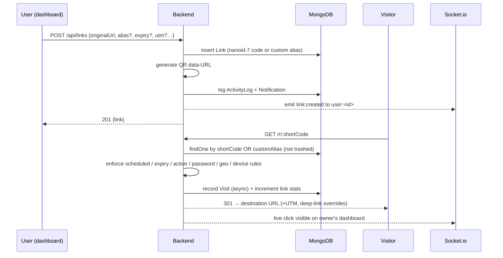

# SnapLink AI — Architecture

Deep-dive into how the system is actually structured, based on the source code in this repository. For a visual overview see [`assets/architecture.svg`](assets/architecture.svg); for endpoint details see [`API.md`](API.md).

---

## 1. System Overview

```mermaid
flowchart TB
    subgraph Client["Browser / PWA"]
        UI[React 19 SPA]
        SW[Service Worker<br/>precache + offline shell]
        ST[Zustand stores<br/>auth · UI]
    end

    subgraph Edge["Vercel"]
        FE["React build (dist/)<br/>SPA rewrites + cache headers"]
    end

    subgraph Server["Render — Express 5"]
        MW["helmet · cors whitelist · morgan<br/>compression · cookie-parser · rate limiters"]
        AUTH["auth middleware<br/>protect · requireAdmin"]
        R["16 route modules"]
        RED["/r/:shortCode<br/>redirect engine"]
        WS[Socket.io server]
        SEED["demoSeed.js<br/>boot-time idempotent seeding"]
    end

    DB[(MongoDB Atlas<br/>18 models via Mongoose)]
    AI[Google Gemini<br/>gemini-2.5-flash]

    UI --> FE
    SW -. caches .-> FE
    FE -->|/api/* Bearer JWT| MW
    FE <-. socket.io-client .-> WS
    MW --> AUTH --> R
    R --> DB
    RED --> DB
    WS --> DB
    R --> AI
    MW --> SEED --> DB
```

**Hosting:** frontend on Vercel (static SPA), backend on Render (single Node process serving REST + Socket.io + redirects), MongoDB Atlas for storage. `requireDb` middleware makes every `/api/*` route fail fast with a clear error when the database is down instead of hanging.

---

## 2. Frontend Architecture (`frontend/`)

| Layer | Implementation |
|-------|----------------|
| Build | Vite + `vite-plugin-pwa` (Workbox `generateSW`), output `dist/` |
| Routing | React Router 7 — public routes (`/`, `/login`, `/signup`, `/verify-email`, …) + `/dashboard/*` protected by an auth guard reading the Zustand auth store |
| State | Zustand stores (auth session, UI state); TanStack Query for server data caching |
| Styling | Tailwind CSS with design tokens (`--text-primary`, `--bg-surface`, …); Framer Motion for animations |
| Realtime | `socket.io-client` joining `user:<id>` rooms for live link/notification events |
| API access | Axios instance configured from `src/config/env.js` — `VITE_API_URL` with prod/dev fallbacks |
| PWA | Precached app shell; navigations fall back to the cached shell offline; `index.html`/`sw.js` served `must-revalidate` so deploys propagate |

Key directories: `src/pages/` (route pages), `src/components/` (shared, dashboard, `auth/AuthLayout.jsx` split-screen auth shell), `src/store/`, `src/hooks/`, `src/config/`.

---

## 3. Backend Architecture (`backend/`)

```
src/
├── server.js            # Express app, middleware chain, route mounting, /health, boot seeding
├── configs/             # db.js (connection w/ fail-fast + retries), gemini.js, multer.js, mailer
├── controllers/         # auth, user, link, redirect, analytics, ai, qr, bio
├── routes/              # 16 route modules (see API.md)
├── models/              # 18 Mongoose models
├── middlewares/         # auth.middleware (protect/requireAdmin), rateLimiter, errorHandler, requireDb
├── utils/               # jwt.utils, apiResponse, helpers (UA/geo/IP parsing), email, demoSeed, logger, corsOrigins
└── sockets/             # socketManager (auth'd user rooms)
```

**Middleware chain for `/api/*`:** general rate limiter → `requireDb` → route-level `protect` → handler. Auth endpoints additionally use `authLimiter`; AI endpoints use `aiLimiter`.

### Data model (core relationships)



Notable fields/behaviors:

- **`Link`** — `shortCode` (nanoid-7, unique index), optional unique-sparse `customAlias`, `utmParams`, `expiresAt`, `scheduledAt`, `isPasswordProtected` + bcrypt-hashed `password`, `isOneTime`, `isTrashed`/`isArchived`/`isActive` lifecycle flags, `geoRestrictions`/`deviceRestrictions`, `deepLink` (Android/iOS), cached `stats` (total/unique clicks, last click), embedded `qrCode` data-URL.
- **`Visit`** — one document per redirect: device/browser/OS (parsed UA), country/city (geoip-lite), `ipHash` (hashed IP for unique-click dedup), referrer, UTM params, bot flag.
- **`User`** — bcrypt password (`select: false`), `isDemo` flag, plan/role, stats cache, lockout fields (`loginAttempts`, `lockUntil`).

---

## 4. Authentication Flow



- **Two secrets** (`JWT_SECRET`, `JWT_REFRESH_SECRET`) — the app refuses to boot without them.
- Cookies are `httpOnly`, `SameSite=None; Secure` in production (cross-site Vercel↔Render), `lax` in dev.
- Lockout after repeated failures (`423`), except the public demo account which is auto-unlocked on boot.
- Demo accounts are flagged `isDemo` and blocked server-side from password change, account deletion and password reset.

---

## 5. URL Creation → Redirect → Tracking Flow



Redirect rule precedence (verified in `redirect.controller.js`): not found/trashed → scheduled → expired → inactive → password → geo restrictions → device restrictions → track → 301.

---

## 6. Demo Account Seeding Flow

```mermaid
flowchart LR
    A[server.js boot] --> B[connectDB resolves<br/>readyState === 1]
    B --> C["ensureDemoAccount()<br/>utils/demoSeed.js"]
    C --> D{demo@gmail.com exists?}
    D -->|no| E[create user<br/>bcrypt demo123<br/>isDemo: true]
    D -->|yes| F["force demo flags<br/>clear lockout<br/>verify/reset password"]
    E --> G["seed missing demo data<br/>(idempotent)"]
    F --> G
    G --> H["5 links + ~870 visits<br/>3 campaigns · QRs · notifications · activity"]
    H --> I["/health → demoSeedStatus: ok"]
```

Design decisions:

- Runs **after** `connectDB()` resolves; a `db.js` bug (waiter hanging on readyState `2`) once silently skipped it — fixed and now observable via `/health`.
- **Idempotent:** only creates what's missing (`Link.exists` / `Notification.exists` checks), so restarts never duplicate data and deleting demo data acts as a soft reset on next boot.
- **Self-healing credentials:** if `demo@gmail.com` exists with a different password (e.g. an old personal account), it is reclaimed on boot so the public demo button always works; the account is forcibly flagged `isDemo`, unlocked, and named "Demo User".
- The demo user's old links (owner's data) are preserved, not wiped.

---

## 7. AI Integration

`backend/src/configs/gemini.js` wraps `@google/generative-ai`:

- Model: `GEMINI_MODEL` (default `gemini-2.5-flash`), key from `GEMINI_API_KEY`.
- Consumers (`backend/src/controllers/ai.controller.js`, also used inside `link.controller.js`): slug suggestions, analytics insights, URL safety checks, performance prediction, URL summarization, chat assistant, campaign suggestions.
- The chat/insight prompts receive the user's **real** link and visit statistics — no fabricated data.
- Without a configured key the AI endpoints return a graceful "not configured" response; the rest of the app is unaffected.

---

## 8. Realtime Layer

- Socket.io server shares the Express HTTP server; sockets authenticate with the JWT and join a `user:<id>` room.
- Events emitted server-side: `link:created` (on creation), notification pushes, visit activity — consumed by the dashboard for live counters and toast updates.
- The redirect controller records visits and bumps stats without waiting on sockets (async, non-blocking).

---

## 9. Deployment Topology

```
Browser ──HTTPS──▶ Vercel (static SPA, SPA rewrites, immutable /assets cache)
                  │
                  ├──HTTPS /api/*──▶ Render (Express, Node 20) ──▶ MongoDB Atlas
                  │                        │
                  └──WS socket.io──────────┘
                  │
                  └──GET /r/:code──▶ Render redirect engine ──▶ 301 destination
```

- CORS whitelist built from `FRONTEND_URL`/`CLIENT_URL` — no wildcard.
- `frontend/vercel.json` handles SPA fallback and cache strategy (see [`DEPLOY.md`](../DEPLOY.md)).
- `/health` exposes `status`, `mongo`, `demoSeed`, `demoSeedStatus`, `version` for uptime checks and deploy verification.

---

## 10. Legacy / Removed

- **Bio pages** (`/api/bio`, bio controller/model) remain in the backend but were removed from the frontend UI — treated as legacy; not documented as a user-facing feature.
- **Admin API** (`/api/admin`) exists with `requireAdmin` enforcement, but there is no admin UI in the frontend yet.
