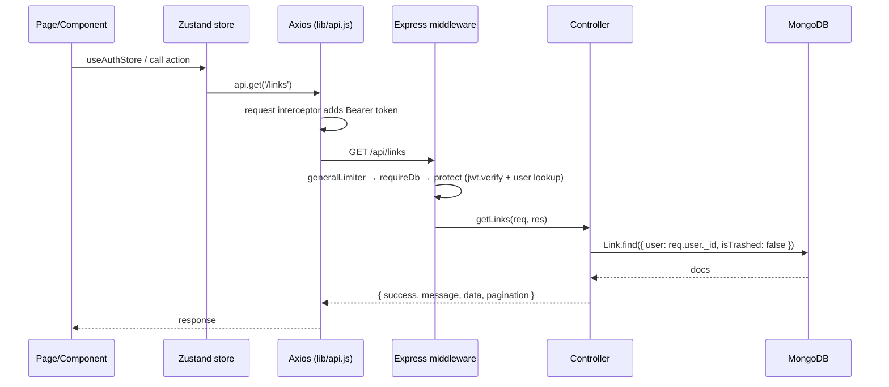
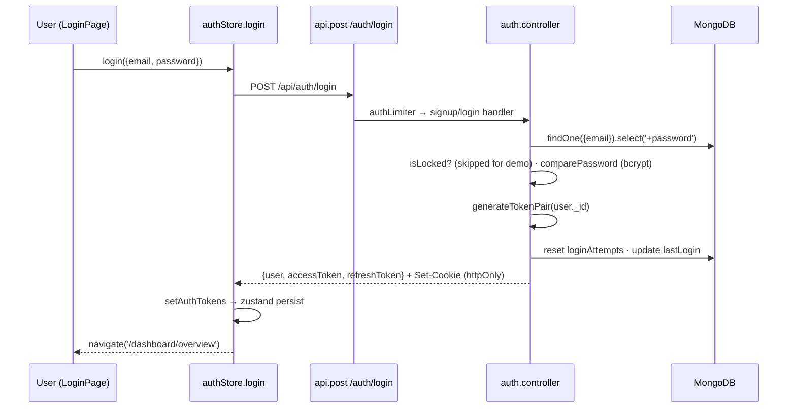
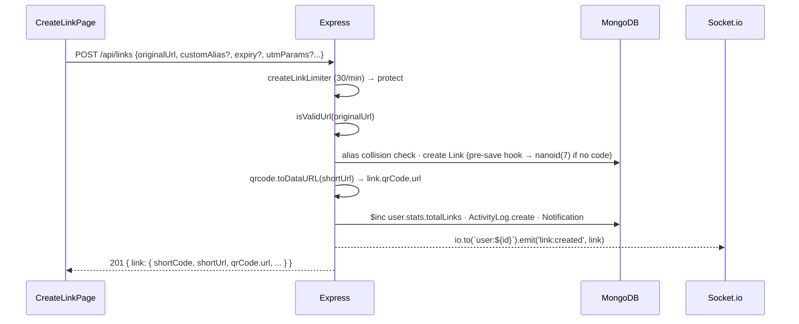
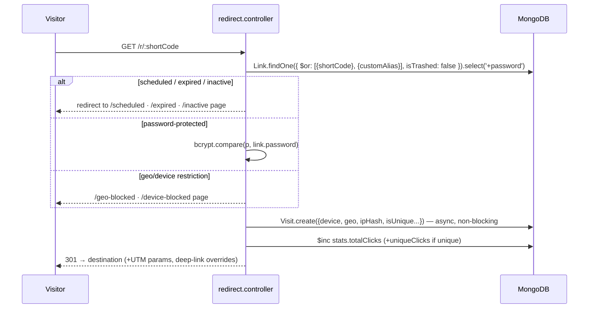
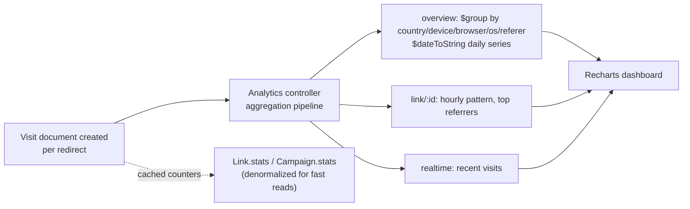
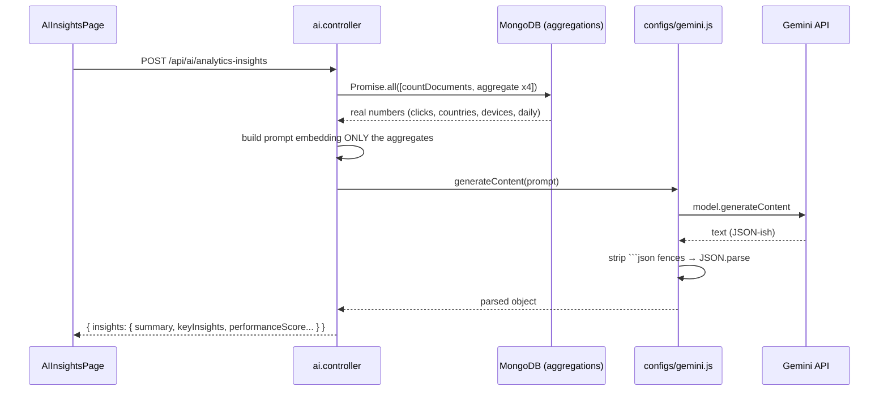

# Chapter 3 — Project Architecture

## 1. Overall system architecture

```mermaid
flowchart TB
    subgraph Client["Browser / PWA"]
        UI[React 19 SPA]
        SW[Service Worker<br/>precache]
    end

    subgraph Vercel["Vercel (static hosting)"]
        FE["dist/ + SPA rewrites<br/>immutable /assets cache"]
    end

    subgraph Render["Render (Node 20 process)"]
        MW["helmet · cors whitelist · compression<br/>morgan · json limit · cookieParser<br/>rate limiters · requireDb"]
        API["17 route mounts<br/>/api/auth /api/links /api/ai ..."]
        RED["GET /r/:shortCode<br/>redirect engine"]
        WS[Socket.io]
        SEED["demoSeed.js<br/>idempotent boot seeding"]
    end

    DB[(MongoDB Atlas<br/>8 models)]
    GEM[Google Gemini<br/>gemini-2.5-flash]

    UI --> FE
    SW -. caches static assets .-> FE
    UI -->|"/api/* (Bearer JWT)"| MW
    UI <-. socket.io-client .-> WS
    UI -->|"/r/:shortCode"| RED
    MW --> API
    API --> DB
    RED --> DB
    API --> GEM
    SEED --> DB
```

**Step-by-step:**

1. The browser loads the SPA from Vercel. Static JS/CSS are content-hashed and cached for a year; `index.html` is `must-revalidate` so deploys propagate.
2. All API calls go to `https://katomaran-y789.onrender.com/api/*` with a `Bearer` access token (Axios instance in `frontend/src/lib/api.js`).
3. Every API request passes: rate limiter → `requireDb` (fails fast if Mongo is down) → route-level `protect` → controller.
4. Redirect traffic bypasses `/api` entirely — visitors hit `/r/:shortCode` on the backend, which talks to Mongo directly.
5. Realtime: the Socket.io handshake carries the JWT; after verification the socket joins room `user:<id>`.
6. AI calls happen **server-side only** — the Gemini key never reaches the browser.

## 2. Frontend → backend request flow (generic authenticated call)



**Failure path (important!):** if the response is `401` and the endpoint isn't an auth endpoint, the response interceptor in `lib/api.js` triggers a **single-flight refresh** — many parallel 401s share one `POST /auth/refresh-token` (`refreshPromise` memoization). If refresh succeeds the original request is retried with the new token; if the refresh itself is 401/403, tokens are cleared and a `snaplink:auth-expired` window event resets the Zustand store.

## 3. Authentication flow



Details to quote: access token lives in memory + Zustand-persisted storage; refresh token is httpOnly (JS can't read it via `document.cookie`); on app load `initializeAuth()` calls `GET /auth/me` **once** to validate the persisted session before routes render.

## 4. URL shortening flow



## 5. Redirect flow (the hot path)



Key design decision: **Visit creation and stats increment happen inside `Visit.create(...).then(...)` — the redirect never waits for them.** Visitor latency is one Mongo read + a 301.

## 6. Analytics tracking flow



## 7. Gemini AI integration flow



Failure handling: 404 model → auto-retry with `gemini-2.5-flash`; invalid key / quota / unknown error → `fallbackResponse(prompt, reason)` returns either a helpful message or canned JSON so the frontend keeps working. AI rate limit: **10 requests/minute/user** (`aiLimiter`).

## 8. Demo account initialization flow

```mermaid
flowchart LR
    A[server.js starts] --> B[connectDB resolves<br/>readyState 1]
    B --> C[ensureDemoAccount]
    C --> D{demo@gmail.com exists?}
    D -->|no| E[create User<br/>bcrypt demo123 · isDemo true]
    D -->|yes| F["force demo flags · clear lockout<br/>verify password · reclaim if drifted"]
    E --> G[ensureDemoData — idempotent]
    F --> G
    G --> H["5 sample links · ~870 Visits · 3 campaigns<br/>QR data-URLs · notifications · activity logs"]
    H --> I["/health → demoSeedStatus: ok"]
```

Why idempotent matters: Render restarts often; the seed only creates **missing** items (`Link.exists` checks), so restarts never duplicate data, and a demo user deleting data gets it restored on next deploy/restart — a soft reset. Status (`pending`/`ok`/`error: …`) is exposed on `/health` because the seed originally failed silently (see Chapter 10).

---

## Frontend architecture summary

| Layer | Files | Pattern |
|---|---|---|
| Routing | `App.jsx` | React Router 7; lazy pages via `lib/lazyWithRetry.js` |
| Layouts | `layouts/DashboardLayout.jsx`, `PublicLayout.jsx` | shell + `DashboardHeader` + `Sidebar` |
| State | `stores/authStore.js` (persist), `stores/uiStore.js` | Zustand |
| Server state | TanStack Query hooks in pages | cache + invalidation |
| HTTP | `lib/api.js` | Axios + interceptors + single-flight refresh |
| Forms | auth pages | react-hook-form + zod |
| Realtime | socket client | room `user:<id>` |
| UI kit | `components/ui/*` | Button, Input, StatCard, PageTransition, BottomSheet, ThemeToggle… |

## Backend architecture summary

```
backend/src/
├── server.js              # app assembly, /health, boot seeding
├── configs/               # db.js, gemini.js, multer.js, mailer
├── controllers/           # auth, user, link, redirect, analytics, ai, qr, bio
├── routes/                # 16 route modules (thin — delegate to controllers)
├── models/                # 8 Mongoose models
├── middlewares/           # auth.middleware, rateLimiter, errorHandler, requireDb
├── utils/                 # jwt.utils, helpers, apiResponse, email, demoSeed, corsOrigins, logger, notification.helper
└── sockets/socketManager.js
```

Principle: **routes are thin, controllers hold logic, utils are shared, models are the single source of schema truth.** Be ready to say you'd extract a `services/` layer if the controllers grew (e.g. link creation logic → `linkService`).
