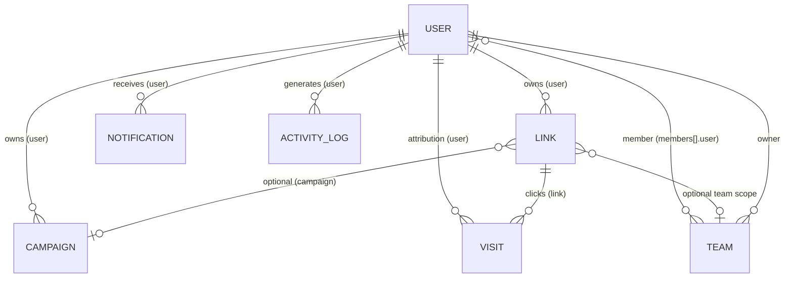

# Chapter 6 — Database Deep Dive

MongoDB Atlas + Mongoose 9. **8 models** in `backend/src/models/`. This chapter covers each schema's fields, types, indexes, and *why* it's shaped that way.

## ER overview



Document DB design philosophy used here: **embed what's read together (stats caches, QR), reference what's relational (user, link, campaign)**.

---

## 1. User (`User.model.js`)

| Field | Type | Notes |
|---|---|---|
| name | String | required, max 100 |
| email | String | required, unique, lowercase, regex-validated |
| password | String | min 8, **`select: false`**, bcrypt-hashed by pre-save hook |
| username | String | unique **sparse**, regex `^[a-z0-9_-]{3,30}$` |
| avatar | String | default null |
| role | String enum | `user | admin | superadmin` |
| isDemo | Boolean | default false (added for the demo account) |
| plan | String | free/… |
| isActive / isBanned | Boolean | moderation + suspension |
| refreshToken | String | persisted for rotation, **`select: false`** |
| emailVerificationToken / emailVerificationExpires | String / Date | SHA-256 hash of the emailed token |
| loginAttempts / lockUntil | Number / Date | brute-force lockout; virtual `isLocked` |
| stats | Object | `totalLinks, totalClicks, totalQRGenerated` (denormalized counters) |
| lastLoginIP, bio, website, location, company, timezone, preferences | mixed | profile |

- **Hooks:** pre-save hashes `password` with `bcryptjs` (`BCRYPT_ROUNDS`, default 10).
- **Methods:** `comparePassword(candidate)` (bcrypt.compare), `incLoginAttempts()` (locks after threshold for 2 h).
- **Why this structure:** lockout fields on the user doc keep brute-force state atomic (`$inc` + conditional `$set`), and sparse-unique username allows nulls for users who never got one.

## 2. Link (`Link.model.js`) — the heart

| Group | Fields |
|---|---|
| Identity | `shortCode` (unique index, nanoid-7 via pre-save), `customAlias` (**sparse unique**), `title`, `description` |
| Destination | `originalUrl` (required), `deepLink {android, ios}` |
| Owner/relations | `user` (ref User, required), `campaign` (ref Campaign), `team` (ref Team) |
| Tags | `tags [String]`, `category` (default 'general'), `aiCategory`, `aiEngagementScore` |
| Lifecycle | `isActive`, `isTrashed`, `isArchived`, `isFavorited`, `isPinned`, `isOneTime`, `isPasswordProtected` + `password` (bcrypt, select:false) |
| Time rules | `expiresAt`, `scheduledAt` |
| UTM | `utmParams {source, medium, campaign, term, content}` |
| Restrictions | `geoRestrictions {allowed[], blocked[]}`, `deviceRestrictions {allowDesktop/Mobile/Tablet}` |
| QR | `qrCode {url, generatedAt}` (embedded data-URL) |
| Cached stats | `stats {totalClicks, uniqueClicks, lastClickAt}` |

**Indexes:**
```js
{ user: 1, createdAt: -1 }        // My Links listing
{ shortCode: 1 }, { unique }      // redirect lookup — the hot path
{ customAlias: 1 }, { unique, sparse }
{ campaign: 1 }                   // campaign dashboards
{ expiresAt: 1 }                  // expiry sweeps/filters
{ isActive: 1, isTrashed: 1, isArchived: 1 }  // list filtering
{ 'stats.totalClicks': -1 }       // top links
```

- **Virtual:** `shortUrl` = `SHORT_URL_BASE + shortCode`.
- **Why nanoid-7:** 62⁷ ≈ 3.5 trillion combos — collision chance negligible at this scale, still short/URL-safe; unique index is the safety net.

## 3. Visit (`Visit.model.js`) — one document per click

Fields: `link` (ref, required), `user` (ref), `shortCode` (**indexed**), request info (`ip`, `ipHash`, `userAgent`, `referer`), parsed geo (`country`, `countryCode`, `city`, `region`, `latitude`, `longitude`), device (`browser`, `browserVersion`, `os`, `osVersion`, `device` enum `desktop|mobile|tablet|bot|unknown`), traffic (`source`, `medium`, `campaign`), `isUnique`, `isBot`, `clickedAt`.

- **Why one-doc-per-click:** flexible aggregation (group by *any* dimension without schema change); MongoDB handles write volume fine at this scale.
- **Trade-off to mention:** at high traffic you'd pre-aggregate into daily rollups or use a time-series collection; today we combine live aggregation with **cached counters on Link/Campaign** for the numbers shown everywhere.

## 4. Campaign (`Campaign.model.js`)

`user` (ref, required), optional `team` ref, `name` (required, max 200), `description`, `status` enum (`draft|active|paused|completed|archived`), `startDate/endDate`, `tags[]`, `color` (default `#6366f1`), UTM defaults (`utmSource/utmMedium/utmCampaign`), **cached `stats {totalLinks, totalClicks, uniqueClicks}`**, AI fields, `timestamps`.

Why: a campaign is an organizational grouping; keeping a stats cache means the campaigns page never needs a full Visit scan.

## 5. Team (`Team.model.js`)

`name` (required), `owner` (ref, required), `slug` (unique, auto from name via `slugify`), `plan`, **embedded** `members[] {user, role(owner|admin|editor|viewer), joinedAt, invitedBy}` and `invitations[] {email, role, token, expiresAt, invitedBy}`, `settings {allowMemberInvites, defaultLinkExpiry, sharedAnalytics}`, `isActive`.

Indexes: `{owner: 1}`, `{'members.user': 1}`, `{slug: 1}`.

Why embed members: a team has few members; embedding avoids joins and makes role checks a single read.

## 6. Notification (`Notification.model.js`)

`user` (ref, required), `type` enum (link_expired, traffic_spike, team_invite, security_alert, system, ai_insight, campaign, report), `title`+`message` (required), `data` (Mixed), `isRead`+`readAt`, `icon`, `link` (in-app deep link), `priority` (low/medium/high/critical).

Indexes: `{user: 1, createdAt: -1}`, `{user: 1, isRead: 1}` — the unread-badge query is `countDocuments({user, isRead: false})`.

## 7. ActivityLog (`ActivityLog.model.js`)

`user` (ref, required), `action` (**strict enum** of ~22 actions: link_created…login_failed), `description`, `metadata` (Mixed), `ip`, `userAgent`, `severity` (info/warning/error/critical). Indexes: `{user: 1, createdAt: -1}`, `{action: 1}`, `{createdAt: -1}`.

Why an append-only log with enum: cheap auditing, type-safe analytics of user behavior; written with `setImmediate` so it never blocks.

## 8. BioPage (`BioPage.model.js`) — legacy

Backs `/api/bio` routes; **removed from the frontend UI**. Mention it as intentionally-retained backend legacy.

---

## How entities relate at runtime

1. **Create link** → `Link.user = req.user._id`; optional `campaign`; `User.stats.totalLinks++`.
2. **Redirect** → new `Visit {link, user, shortCode, ...}`; `Link.stats.totalClicks++` (+unique); if link has a campaign → `Campaign.stats.totalClicks++`.
3. **Dashboard** → reads cached `Link.stats`/`User.stats` for instant numbers, aggregates `Visit` for charts.
4. **Notifications/Activity** → written as side effects of actions, always scoped to `user`.

## Aggregation examples you can quote

Daily clicks (from `analytics.controller.js`):
```js
Visit.aggregate([
  { $match: { user: userId, clickedAt: { $gte: thirtyDaysAgo } } },
  { $group: { _id: { $dateToString: { format: '%Y-%m-%d', date: '$clickedAt' } }, count: { $sum: 1 } } },
  { $sort: { _id: 1 } }
])
```

Device mix: `{ $group: { _id: '$device', count: { $sum: 1 } } }` — same pattern for browser/os/country/referer.

## Database-level decisions worth defending

| Decision | Reason | Trade-off |
|---|---|---|
| Denormalized stats caches | dashboards read counters, not full scans | counters can drift; reconcilable via aggregation |
| One Visit doc per click | flexible analytics | write volume → rollups at scale |
| Embedded QR data-URL | zero extra fetch to display | larger link documents |
| Hashed IP (secret-salted) | privacy + deterministic dedup | cannot recover IP (by design) |
| `bufferCommands: false` | fail fast when DB down | no queuing of writes during outages |
| Sparse-unique customAlias | many links without aliases | partial index, tiny overhead |
